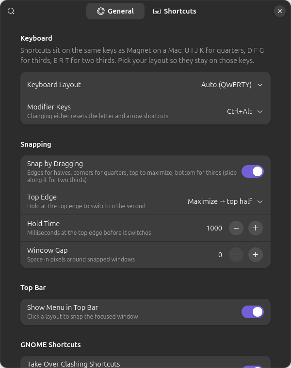

<p align="center"></p>

<h1 align="center">Magnetize</h1>

<p align="center">Magnet-style window snapping for GNOME.<br>
Snap windows to halves, quarters and thirds with the shortcuts you know from macOS, by dragging, or from the top bar.</p>

## Install

```sh
curl -fsSL https://raw.githubusercontent.com/nadelacruz-00/magnetize/main/install.sh | bash
```

Then log out and back in. That's it. Works on GNOME 47 to 50 (tested on 50).

<details>
<summary>Install from a clone, update, or uninstall</summary>

```sh
git clone https://github.com/nadelacruz-00/magnetize && cd magnetize
./install.sh              # install or update
./install.sh --uninstall  # remove
```

Or download the zip from [Releases](https://github.com/nadelacruz-00/magnetize/releases/latest) and run `gnome-extensions install magnetize@nadelacruz-00.github.io.shell-extension.zip`.

</details>

## Shortcuts

The same keys as Magnet, with **Ctrl+Alt** in place of Ctrl+Option:

| | | | |
|---|---|---|---|
| **Halves** | Ctrl+Alt + ← → ↑ ↓ | **Maximize** | Ctrl+Alt+Enter |
| **Quarters** | Ctrl+Alt + U I J K | **Center** | Ctrl+Alt+C |
| **Thirds** | Ctrl+Alt + D F G | **Restore** | Ctrl+Alt+Backspace |
| **Two thirds** | Ctrl+Alt + E R T | **Other display** | Ctrl+Alt+Super + ← → |

Not on QWERTY? Magnetize detects your layout and moves the letters so they stay on the same physical keys. On Colemak, quarters are L U N E. Colemak-DH, Dvorak and Workman work too, and AZERTY and QWERTZ need no changes.

Restore takes a window back to how it was before you first snapped it, even if it was maximized or fullscreen.

## Dragging

Drag a window to a screen edge:

- **Left or right edge:** half
- **Corner:** quarter
- **Top:** maximize. Keep holding there for a second to get the top half instead.
- **Bottom:** thirds. Slide along the bottom into the next third for two thirds.

A preview shows where the window will land, and dragging a snapped window away gives it its old size back. Works with a mouse, a touchscreen or a pen.

## Settings

Open them from the magnet in the top bar, or run `gnome-extensions prefs magnetize@nadelacruz-00.github.io`.



- Keyboard layout (auto-detected) and modifier keys (Ctrl+Alt, Super+Alt or Ctrl+Super)
- Change any shortcut, including fourths and sixths, which start unbound
- Gaps between windows
- What the top edge does (maximize first or top half first) and how long to hold it
- Turn drag snapping or the top-bar menu on or off

## Good to know

- **GNOME shortcuts on the same keys** are taken over while Magnetize is on: Ctrl+Alt+Arrows for workspaces, and on Ubuntu with QWERTY also Ctrl+Alt+T (terminal) and Ctrl+Alt+D (show desktop). Settings lists them, and they come back when you turn Magnetize off. Workspaces still switch with Super+Page Up/Down.
- **Ubuntu's Tiling Assistant** fights with drag snapping. Turn it off: `gnome-extensions disable tiling-assistant@ubuntu.com`

## License

[GPL-2.0-or-later](LICENSE). Not affiliated with Magnet or its makers.
